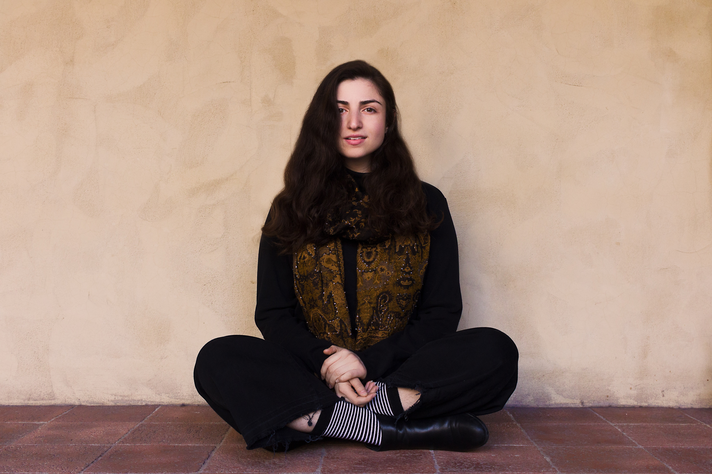

[home](/)&nbsp;&nbsp;&nbsp;&nbsp; [about](/about)&nbsp;&nbsp;&nbsp;&nbsp; [calendar](/calendar)&nbsp;&nbsp;&nbsp;&nbsp; [media](/media)&nbsp;&nbsp;&nbsp;&nbsp; [contact](/contact)

 
Photo by Nuna Ulises

"You should all be fighting for a chance to hear soprano Raha Mirzadegan, whose straight tone soars with opulent richness and resonance." (<i>All Ears</i>)
 
 
Praised for her “stylish elegance and intensity” (<i>Wall Street Journal</i>), soprano Raha Mirzadegan performs internationally in opera, oratorio, choral and chamber music. Equally at home singing medieval chant and cutting-edge premieres, she is known for her “stirring, soulful tones” (<i>The Post & Courier</i>) and “straight tone [that] soars with opulent richness and resonance” (<i>All Ears</i>).
 
 
Highlights from 2025 include a house and role debut as Sesto in Handel’s <i>Giulio Cesare</i> with Ruckus at Hudson Hall, directed by R.B. Schlather. Her “clear tone and arresting agility” (<i>Times Union</i>) were praised as “the revelation of the afternoon” (<i>Observer</i>). In late winter, she joined Theotokos for a residency in Thiré, France as part of the French Ministry of Culture’s Odyssée artist-in-residency program. Hosted by Les Arts Florissants, the group’s performance featured Raha in pairings of Purcell arias and premieres by Doug Balliett.
 
 
Raha’s frequent engagements with new works include her Opera Philadelphia debut as the featured soprano in Karim Sulayman’s Baroque pastiche Unholy Wars. Following her world-premiere of this role at Spoleto Festival USA, <i>Seen and Heard International</i> described her as being “totally at ease in the Baroque style.” Earlier this year, she premiered Doug Balliett’s <i>St. Mark Passion</i> as the soprano soloist. Raha has also performed as Guinevere in Balliett’s opera <i>Gawain and the Green Knight</i>, a role she reprises annually on New Year’s Eve. In 2023, she performed the lead in a workshop of <i>DRIFT</i>, an opera by Alyssa Weinberg and J. Mae Barizo. Other premieres and records include music by Mary Kouyoumdjian, Owen Burdick, Elliot Cole and Eric Pazdziora.
 
 
A devotee of sacred music, Raha was a soloist on The Clarion Choir’s GRAMMY-nominated recording of Rachmaninoff’s <i>All-Night Vigil</i>. She was also a standout soloist in Clarion’s 2024 Ockeghem Marathon at The Met Cloisters and their performance of Bach’s <i>St. John Passion</i> in 2025.
 
 
Raha is the founder of <a href="https://www.hudsonbaroque.com">Hudson Baroque</a>, a non-profit organization that aims to provide soul-nourishing and accessible concerts for all members of the regional community. In collaboration with award-winning, internationally acclaimed instrumentalists and some of America’s finest early music singers, Hudson Baroque is where passion, virtuosity, and historically informed performance practice foster a culture of excellence and goodwill. In March, the ensemble produced a historical replication of Handel’s final performance of <i>Messiah</i>, and in August, they performed <i>A Voice from Heaven</i>, a program of sacred a cappella music curated in collaboration with Andrew Leslie Cooper.
 
 
