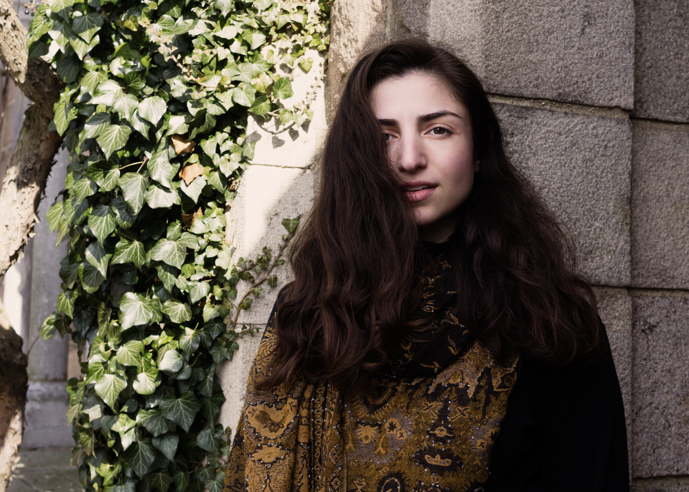

[home](/)&nbsp;&nbsp;&nbsp;&nbsp; [about](/about)&nbsp;&nbsp;&nbsp;&nbsp; [calendar](/calendar)&nbsp;&nbsp;&nbsp;&nbsp; [media](/media)&nbsp;&nbsp;&nbsp;&nbsp; [contact](/contact)
 
Photo by Nuna Ulises
 
 
NEXT UP:
 
 
<b>October 15-18:</b> Serenade to Music with <a href="https://www.seraphicfire.org">Seraphic Fire</a>
 
 
<b>December 31:</b> 
Gawain and the Green Knight 
<i>A Medieval New Year's Legend</i> 
by Doug Balliett 
Raha reprises the role of Guinevere 
New York City
 
 
<b>March 13, 2027:</b> Sprezzatura 
<i>Virtuoso Cello Music of the Early Italian Baroque</i> with Ars Antiqua
 
 
Recent engagements:
 
 
29 May, 1, 3 & 6 June 2022 
<b>Unholy Wars (world premiere)</b> 
Spoleto Festival USA 
Dock Street Theatre, Charleston, SC
 
 
7 February 2023 
THEOTOKOS 
<b>Charpentier: Leçons de ténèbres</b> 
St. Mary's Studio, Manhattan, NY
 
 
<iframe width="100%" height="236" src="https://www.youtube.com/embed/T-QEsYIEjbU?si=N5usxnbVVXHKY3lf" title="YouTube video player" frameborder="0" allow="accelerometer; autoplay; clipboard-write; encrypted-media; gyroscope; picture-in-picture; web-share" referrerpolicy="strict-origin-when-cross-origin" allowfullscreen></iframe>
23, 27, 30 September, & 1 October 2023 
<b>Unholy Wars</b> 
Opera Philadelphia Premiere 
Part of Festival O23
 
 
26-30 October 2023 
<b>DRIFT: An Opera in Three Acts</b> 
New Opera Workshop @ Opera America
 
 
12 November 2023 
<b>Soloist with Theotokos and special guest William Christie of <i>Les Arts Florissants</i></b>
 
 
19 November 2023 
<b>Les chevelures voice-piano recital</b> 
Raha Mirzadegan, soprano 
Sarah Young, piano 
Stone Ridge, New York
 
 
7 December 2023 
<b>Cantatas: Yesterday and Today</b> 
Music of Telemann and Balliett 
Presented by Five Buroughs Music Festival 
THEOTOKOS 
St. Mary's Grand Street, NYC
 
 
31 December 2023 
<b>Gawain and the Green Knight</b> 
<i></i>A Medieval New Year's Legend</i> 
by Doug Balliett 
Raha reprises the role of Guinevere 
New York City
 
 
1-4 January 2024 
<b>Gawain and the Green Knight studio recording</b> 
Oktaven Studios
 
 
18 February 2024 
<b>Les chevelures voice-piano recital</b> 
Raha Mirzadegan, soprano 
Sarah Young, piano 
Stone Ridge, New York 
 
 
28 March 2024 
<b>Marenzio: Salve Regina</b> 
Theotokos, Midtown Concerts
 
 
1 May 2024 
<b>J.S. BACH: MASS IN B MINOR</b> 
Clarion
 
 
12 June 2024 
<b>OCKEGHEM MARATHON AT THE MET CLOISTERS</b
 
 
December 31, 2024: 
<b>Gawain and the Green Knight</b> 
<i>A Medieval New Year's Legend</i> 
by Doug Balliett 
Raha reprises the role of Guinevere 
New York City
 
 
January 2025: Featured soprano in <i>Hosanna!</i> with <b>Hudson Baroque</b>
 
 
February 2025: French Ministry of Culture’s Odysée artist-in-residency program, with <b>Theotokos</b>, hosted by William Christie and <b>Les Arts Florissants</b>
 
 
March 2025: Soloist in New York Premiere of Doug Balliett's <i>St. Mark Passion</i>
 
 
March 2025: Soloist in <i>Messiah</i> with <b>Hudson Baroque</b>
 
 
April/May 2025: House and role debut as Sesto in <i>Giulio Cesare</i> with <b>Ruckus</b> at Hudson Hall, directed by R.B. Schlather
<iframe width="100%" height="236" src="https://www.youtube.com/embed/4wEbXnwlaMo?si=CAQd-PcvvcPtxMAY" title="YouTube video player" frameborder="0" allow="accelerometer; autoplay; clipboard-write; encrypted-media; gyroscope; picture-in-picture; web-share" referrerpolicy="strict-origin-when-cross-origin" allowfullscreen></iframe>
 
 
April 2025: Soloist in Bach's <i>St. John Passion</i> with <b>Clarion</b>
 
 
August 2025: <i></i>A Voice from Heaven</i> with <b></b>Hudson Baroque</b>
 
 
November 2025: Angel in the world premiere of <i><a href="https://www.laopera.org/performances/2026/hildegard">HILDEGARD</a></i> 
by Sarah Kirkland Sneider at <b>LA Opera</b>
 
 
January 2026: Angel in the New York premiere of <i><a href="https://www.prototypefestival.org/shows/hildegard">HILDEGARD</a></i> 
by Sarah Kirkland Sneider at <b>Prototype Festival</b>
 
 
February 14-15, 2026: Teodosia in Scarlatti's <i><a href="https://sacreddrama.org/event/teodosia-ns/">Il martirio di Santa Teodosia</a></i> 
with <b>Academy of Sacred Drama</b>
 
 
March 2026: Tour of Handel's <i>Hercules</i>  with <b>The English Concert</b> and <b>Clarion</b>
 
 
April 2026: <i>Divas & Strings</i> with <b>Musimelange</b> in Miami, Florida
 
 
July 2026: <i>How Can I Keep From Singing?</i> 
Guest Artist / Soloist with <b></b>Civic Chorale of Greater Miami</b>
